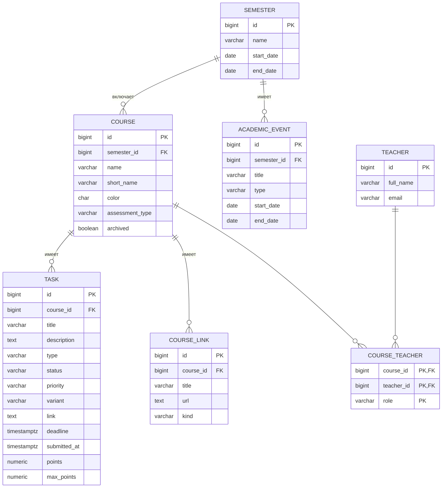

# Схема базы данных StudyHub

Схема создаётся и меняется только миграциями Flyway
(`server/src/main/resources/db/migration`). Hibernate работает в режиме
`validate`: проверяет, что Java-классы совпадают с таблицами, но сам их не меняет.

## Диаграмма

## Таблицы

| Таблица | Что хранит |
|---|---|
| `semester` | Учебный семестр с датами начала и конца. |
| `academic_event` | События учебного календаря: сессия, каникулы, зачётная неделя, выходные. |
| `teacher` | Преподаватели. |
| `course` | Предметы. Принадлежат семестру. Есть полное и короткое название, цвет, форма контроля (экзамен, дифф. зачёт, зачёт). |
| `course_teacher` | Связь «многие ко многим» между предметами и преподавателями, с ролью: лектор, практик, лабораторные. |
| `course_link` | Ссылки предмета: LMS, чат, папка с материалами, записи, репозиторий. |
| `task` | Работы с дедлайнами: лабы, практики, отчёты, экзамены. Хранят статус, приоритет, вариант, баллы. |

Статусы задачи: `TODO` → `IN_PROGRESS` → `READY` (сделано, но не сдано) → `SUBMITTED` (сдано).

## Оценки (балльно-рейтинговая система)

- У каждой задачи есть `points` (сколько получено) и `max_points` (сколько можно получить).
- Итоговые баллы по предмету = сумма `points` всех его задач. **Итог в базе не хранится**, а считается:
  это производные данные, и при хранении они могли бы разойтись с исходными.
- Баллы не за работы (посещаемость, активность) заводятся задачей с типом `OTHER`.
- Сумму `max_points` по предмету (обычно 100) база проверить не может (`CHECK` видит одну строку),
  поэтому это проверяется в приложении.

Перевод баллов в оценку:

| Баллы | Экзамен / дифф. зачёт | Зачёт |
|---|---|---|
| меньше 61 | неудовлетворительно | не зачтено |
| 61 ≤ x < 76 | удовлетворительно | зачтено |
| 76 ≤ x < 90 | хорошо | зачтено |
| 90 и больше | отлично | зачтено |

**Допущение:** в официальной таблице границы 76 и 90 указаны в двух соседних строках.
Принимаем полуоткрытые интервалы: ровно 76 баллов — «хорошо», ровно 90 — «отлично».
Пороги хранятся в коде, так как это общее правило вуза, а не данные пользователя.

## Принятые решения

1. **Преподаватели — отдельная таблица**, а не строка в `course`: нет дублей и опечаток,
   у предмета может быть несколько преподавателей с разными ролями.
2. **`variant` — строка**: варианты бывают не только числами («3б»).
3. **`points` и `max_points` — `NUMERIC(5,2)`**, а не числа с плавающей точкой:
   точное десятичное значение без ошибок округления.
4. **`color` хранится как `#RRGGBB`**, формат проверяется регулярным выражением в `CHECK`.
5. **`submitted_at` можно заполнить только у задачи со статусом `SUBMITTED`** (проверка в `CHECK`).
6. **Удаление семестра с предметами запрещено** (`ON DELETE RESTRICT`).
   Удаление предмета удаляет его задачи, ссылки и связи с преподавателями (`ON DELETE CASCADE`).
7. **`archived`** позволяет вручную скрыть предмет, не дожидаясь конца семестра.
8. **Индексы на всех внешних ключах**: Postgres сам создаёт индекс только для первичного ключа.
   Для поиска ближайших дедлайнов — частичный индекс только по несданным задачам.

## Что добавится позже

- `lesson` — пары из расписания Политеха (декабрь, задача 2.2).
- `app_user` — пользователи; у предметов появится владелец (январь, задача 3.1).
- `document` — загруженные конспекты и методички (февраль, задача 4.1).
- `task_step` — подзадачи-чеклист (когда-нибудь потом).